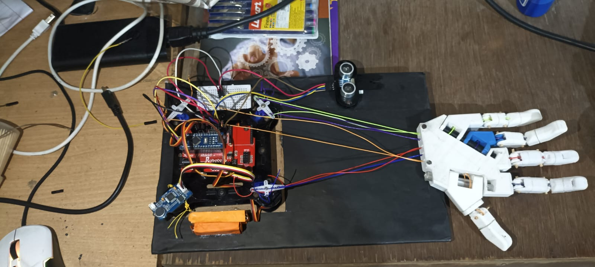

# Bionic_arms
The project use Arduino voice recognition module v3 sensor for moving servo motor Voice sensor allow user to  measure’s sound generated by mouth when person is giving command with the help of micro phone which is an input for an user.The voice module send the data to Arduino uno for the  compilation of command’s After compilation the main board execute the output with help of servo motor .The servo motor are capable of opening up their fingers  for to grape an object or material
# voice controller

# 🚧 Under active development.
